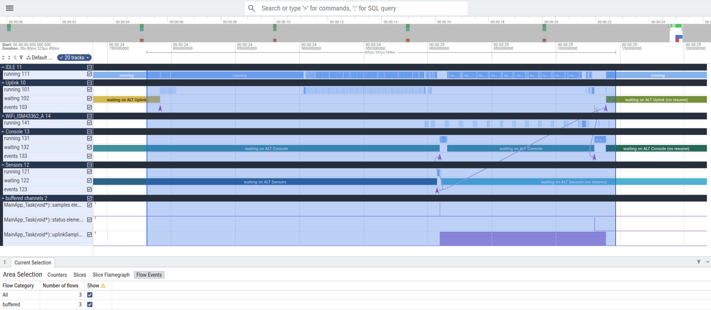

# 6. Tracing: watching the process network at work

The build configuration **Debug-Trace** records what the processes do -- every channel operation,
every ALT, every wait and wake-up, every thread switch -- into a ring buffer in RAM. You stop the
board in the debugger, copy the ring to the PC, convert it and look at it as a timeline in Perfetto.
This chapter takes you through it step by step.

> **Note: an unreleased trace format.** Debug-Trace uses the source of CSP4CMSIS's unreleased
> `dev/tracing` branch (version 3.2.0 in `csp_version.h`, commit `ca2610a`, in `lib/csp4cmsis-trace/`;
> see its `VERSION`). The record format, the event numbers and the tools may still change before a
> release. Debug and Release use the released CSP4CMSIS 3.1.0 (`lib/csp4cmsis/`) and contain no trace
> code at all: they build to exactly the same image as without Debug-Trace (checked,
> `docs/results/2026-11-14_tracing.md`).

**Tested with:** the tools of chapter 1, Python 3.13 (Ubuntu 25.04), Google Chrome with
<https://ui.perfetto.dev>, and optionally ProB 1.x (`probcli`) for the conformance check. Windows: the
Python scripts run unchanged; the shell scripts in `tools/` need Git Bash or WSL (not tested).

---

## 6.1 What gets recorded, and where

| Part | File | What it does |
|---|---|---|
| Trace hooks in the library | `lib/csp4cmsis-trace/csp4cmsis/...` (`CSP4CMSIS_TRACE`) | each channel put/get, ALT guard/selection/deadline, wait/resume becomes an event |
| Ring backend | `lib/csp4cmsis-trace/csp4cmsis/src/csp_trace_ring.c` (`CSP4CMSIS_TRACE_BACKEND_RING`) | writes each event as a 16-byte record: cycle-counter time stamp, event id, sequence number, two values |
| The ring | `Core/Src/csp_trace_board.c`, `csp_trace.ld` | 1024 records (16 KB + 32-byte header) in SRAM2 at `0x10000000`, `NOLOAD`: flashing does not touch it, `csp_trace_ring_init()` clears it before `main()` |
| Heartbeat | `vApplicationTickHook()` in `csp_trace_board.c` | one record per second, so that the 32-bit cycle counter can be unwrapped |
| Thread switches | `Core/Inc/FreeRTOSConfig.h`, USER CODE Defines | FreeRTOS's `traceTASK_CREATE`, `traceTASK_SWITCHED_IN/OUT` hooks: which thread runs when |
| Trigger | `Core/Src/trace_trigger.c` | the user button B1 or a call `trace_trigger(post_ms)`: the core halts `post_ms` later if a debugger is attached (6.6) |
| HAL time base | `Core/Src/main.c`, USER CODE SysInit | TIM6 stops while the core is halted (`__HAL_DBGMCU_FREEZE_TIM6()`, 6.6) |

All of these exist only when `CSP4CMSIS_TRACE` is defined, which only Debug-Trace does. The hooks in
`FreeRTOSConfig.h` sit in a USER CODE section and survive regeneration in STM32CubeMX (checked).

**How long the ring lasts.** Measured on the board (`docs/results/2026-11-14_tracing.md`): between
uploads the program writes about 13 records per second -- a heartbeat per second and about 59 records
per sample every 5 s (Sensors reads, Console prints, Uplink takes the sample). One ThingSpeak upload
writes about 690 records in 0.35 s, up to 4500 per second: the Wi-Fi driver waits for the module by
checking a pin every millisecond, and each check is a thread switch to the idle thread and back. The
ring keeps the **newest** 1024 records (policy *overwrite*): about one upload plus 20 s of normal
work. So:

**Dump the ring within about 20 s after an `Uplink: ... -> entry` line** if you want to see an
upload. Later, the upload has been overwritten by normal work. (SRAM2 cannot hold a larger ring:
2048 records would be 32 KB + 32 bytes. The other policy, *stop when full*, would keep only the
first 1024 records after reset -- the Wi-Fi join fills those within a second.)

---

## 6.2 Build and run Debug-Trace

1. STM32CubeIDE: **Project > Build Configurations > Set Active > Debug-Trace**, then **Project >
   Build Project**. Headless:
   ```bash
   ~/st/stm32cubeide_2.1.0/headless-build.sh -data /tmp/ws -import "$PWD" -build DISCO_L475VG_IOT01A_Thingspeak/Debug-Trace
   ```
   You should now see `Build Finished. 0 errors, 0 warnings.` and
   `Debug-Trace/DISCO_L475VG_IOT01A_Thingspeak.elf`.
2. Flash it with the shared launch configuration **Run > Debug Configurations... > Debug-Trace (flash
   and debug) > Debug**, then press **Resume** (F8) and **Terminate**. Have a serial terminal open on
   the virtual COM port. The console output is the same as in Debug. Do not use **Run As** or
   **Debug As** from chapter 3: they reuse the launch configuration made there, which flashes the
   Debug ELF (6.3, *Dump from STM32CubeIDE by hand*). Without the GUI:
   `tools/flash_and_capture.sh Debug-Trace/DISCO_L475VG_IOT01A_Thingspeak.elf 90 trace_out/console.txt`.
3. Wait for an upload line, e.g.
   `[  75.681 s] Uplink: sample #16 -> entry 236394 (331 ms)`, then go to 6.3 within 20 s.

---

## 6.3 Copy the ring to the PC

The ring must be read while the core is **halted**, so that it does not change during the copy.

**With the script** (Ubuntu; it starts the ST-LINK GDB server in *attach* mode -- no reset --, lets GDB
connect, which halts the core, dumps the ring, reads the threads' names, and lets the board run on;
to stop at a chosen moment instead -- a source line, or a press of B1 -- see 6.6):

```bash
tools/trace_dump.sh Debug-Trace/DISCO_L475VG_IOT01A_Thingspeak.elf trace_out/ring.bin
```

You should now see the ring header, the thread names and

```
$1 = {magic = 0x52505343, format = 0x1, record_size = 0x10, capacity = 0x400, policy = 0x0, write_count = 0x319c8, clock_hz = 0x4c4b400, dropped = 0x0, dwt_ctrl = 0x40000001}
TASKNAME 0x20001138 Sensors
TASKNAME 0x20001a70 Console
TASKNAME 0x20002ba8 Uplink
TASKNAME 0x20003ac4 WiFi_ISM43362_A
TASKNAME 0x2000a3c4 IDLE
== wrote trace_out/ring.bin (16416 bytes) and trace_out/ring.names (5 names); the board is running again
```

`magic` 0x52505343 is "CSPR"; `capacity` 0x400 = 1024 records; `clock_hz` 0x4c4b400 = 80 MHz.

The dump is two files: `ring.bin`, the ring as it is in RAM (32-byte header and 1024 records of
16 bytes: 16416 bytes), and `ring.names`, the process names. There is no `trace.json` yet: it is
made from these two files by `tools/trace_decode.sh` (6.4), which is what you open in Perfetto.

**Why the names are read separately.** The decoder names a thread after its process's `name()`
(`SensorsProcess::name()` returns `"Sensors"`, and so on). CSP4CMSIS records that name once, when the
process starts (`ProcessName`); in an overwrite ring that holds an upload, those records were
overwritten long ago, and the decoder would fall back to the symbol of the thread's control block
(`MainApp_Task(void*)::sensors`). The name is also in FreeRTOS's control block (`pcTaskName`:
CSP4CMSIS's `Run` passes `name()` to `osThreadNew`), so the script reads it there while the core is
halted (`tools/trace_names.py`) and writes `ring.names`, which 6.4 uses. FreeRTOS keeps at most 15
characters (`configMAX_TASK_NAME_LEN` 16), hence `WiFi_ISM43362_A` for the Wi-Fi driver's thread.

### Dump from STM32CubeIDE by hand

The same dump without the script, in STM32CubeIDE's debugger (also on Windows; the steps below were
written on Ubuntu). The project ships two **shared launch configurations** for this, as files in
the project folder; after the import they are listed under **Run > Debug Configurations... > STM32
C/C++ Application**:

| Launch configuration | Builds | Downloads | Resets | Stops | Use it to |
|---|---|---|---|---|---|
| **Debug-Trace (flash and debug)** | Debug-Trace | yes | yes (connect under reset) | at `main` | put the Debug-Trace build on the board |
| **Debug-Trace (attach, dump)** | no | no | no | where the program is when the debugger connects | copy the ring of the running program |

Both use `Debug-Trace/DISCO_L475VG_IOT01A_Thingspeak.elf`, whatever configuration is active.

**Do not use Run > Debug As, or the debug (bug) button without a choice.** Both start the launch
configuration of the *active* build configuration, which after an import is Debug. Such a session:

- loads the Debug ELF, which has no ring, so `csp_trace_ring` is an unknown symbol;
- **flashes the Debug build**, so the board no longer runs Debug-Trace;
- resets the board, so whatever was in the ring is gone.

`csp_trace_ring_init()` clears the ring at every start, and every launch that downloads also resets.
So only a session that attaches without download and reset can copy the ring of a running program.

1. **Make Debug-Trace the active configuration.** Use **Project > Build Configurations > Set Active >
   Debug-Trace**, or the arrow next to the hammer button. The hammer button and **Run > Debug As** now
   use Debug-Trace too, and the editor shows the `CSP4CMSIS_TRACE` code as active.
2. **Flash once.** Choose **Run > Debug Configurations... > Debug-Trace (flash and debug) > Debug**.
   It builds Debug-Trace, downloads it, resets the board and stops at `main`. Press **Resume** (F8),
   then **Terminate** (red square, Ctrl+F2). In the serial terminal you should now see the Debug-Trace
   start-up (6.2) and then the uploads. The board keeps this build until you flash another one.
3. **Wait for what you want in the ring.** To see an upload, attach within about 20 s after an
   `Uplink: ... -> entry` line (6.1).
4. **Attach.** Choose **Run > Debug Configurations... > Debug-Trace (attach, dump) > Debug**.
   Connecting halts the core where it is. The **Debug** view shows the threads as *Suspended*, and the
   serial console stops printing.
5. **Check the ELF.** In the **Debugger Console** tab (Console view, the console of this session),
   type `info files` and `p &csp_trace_ring`. You should now see (your folder instead of
   `/home/<you>`):

   ```
   Symbols from "/home/<you>/DISCO_L475VG_IOT01A_Thingspeak/Debug-Trace/DISCO_L475VG_IOT01A_Thingspeak.elf".
   ...
   $1 = (struct csp_trace_ring *) 0x10000000 <csp_trace_ring>
   ```

   `Debug-Trace/` in the first line, and an address in SRAM2 (`0x10000000`): this is the right ELF.
   `.../Debug/...elf` and `No symbol "csp_trace_ring" in current context.`: wrong session (see below).
6. **Dump to an absolute path.** A relative name ends up in the debugger's working directory, which
   depends on the launch. Create the folder first (e.g. `mkdir -p ~/trace_out` in a terminal), then type:

   ```
   dump binary memory /home/<you>/trace_out/ring.bin &csp_trace_ring ((char *)&csp_trace_ring) + sizeof(csp_trace_ring)
   ```

   GDB does not create folders. Give the full path, not `~`. On Windows write it with forward slashes,
   e.g. `C:/Users/<you>/trace_out/ring.bin` (not tested). The file must be 16416 bytes
   (`ls -l ~/trace_out/ring.bin`).
7. **Process names (optional).** Without `ring.names`, the threads keep their symbol names in
   Perfetto. To get the process names:
   - for each thread address, type `print ((TCB_t *)0x20001138)->pcTaskName`;
   - write the lines `TASKNAME <address> <name>` into `ring.names` next to `ring.bin`, in the format
     shown above.
8. **Let the board run on.** Press **Resume** (F8), then **Terminate**. The console prints again.
   The board runs without a reset; time on the board stood still while it was halted (6.6).
9. **Decode** in a terminal, in the project folder:

   ```bash
   tools/trace_decode.sh ~/trace_out/ring.bin Debug-Trace/DISCO_L475VG_IOT01A_Thingspeak.elf ~/trace_out
   ```

   This gives `~/trace_out/trace.json` for Perfetto (6.4, 6.5).

**What to keep in mind:**

- **`No symbol "csp_trace_ring" in current context.`** The session loaded an ELF without the ring.
  Usually that is the Debug ELF of the default launch; `info files` names it. Terminate it and use
  **Debug-Trace (attach, dump)**. If that session flashed the board, the board now runs Debug: flash
  Debug-Trace again (step 2) and wait (step 3).
- **Every flash wipes the ring.** A download includes a reset, and the reset starts a new, empty ring.
  This applies to the flash launch, the default launch and **Run**. Dump before flashing, never after.
- **The attach launch does not build.** If you have changed the code since step 2, the ELF on the PC
  no longer matches the program on the board. Addresses and symbols would then be wrong. Flash again
  first.
- **A debug session leaves the debug-enable bit set.** `C_DEBUGEN` in `CoreDebug->DHCSR` is set by
  both launches, and stays set after **Terminate** and after the RESET button, until the USB cable
  is unplugged. While it is set, a press of **B1** stops the board at the trigger's breakpoint
  (6.6), with no debugger to continue it: the console stops. Unplug and replug the USB cable before
  using B1 without a debugger.

---

## 6.4 Convert and check

```bash
tools/trace_decode.sh trace_out/ring.bin Debug-Trace/DISCO_L475VG_IOT01A_Thingspeak.elf trace_out
```

runs, from CSP4CMSIS's `tools/trace`:

1. `ring2log.py ring.bin -o events.log --report ring_report.txt` -- the records as an Event Recorder
   log. **Check the report** (example):
   ```
   ring: capacity 1024 records, policy overwrite oldest, write count 21721, clock 80000000 Hz, DWT_CTRL 0x40000001
   records kept: 1024 (write index 20697..21720); overwritten 20697; dropped 0; torn 0; orphan continuation records 0
   events: 885 over 27.000000 s (33 events/s, 38 records/s)
   heartbeats: 28 (beats 52..79); intervals not about 1 s: none
   ```
   `torn 0` (no record half-written when the core was halted), `orphan continuation records 0` (no
   multi-record event cut in half by the ring's wrap), `dropped 0`, and heartbeats 1 s apart: the
   ring is consistent. "Overwritten" is expected with the overwrite policy.
2. `decode.py -a <elf> -I trace/FreeRTOS_ring.scvd --no-eventlist events.log -o events.csv
   --summary summary.txt --checks checks.json --stable stable.csv --perfetto trace.json` -- names the
   events, resolves addresses to symbols (`MainApp_Task(void*)::uplinkSamples` for the channel object),
   checks the library's state, and writes the Perfetto file. **`--no-eventlist` is the normal path:**
   `decode.py` then reads the log itself, which covers everything this project records (CSP4CMSIS and
   FreeRTOS events), and you need nothing beyond Python 3. `eventlist` from Arm's CMSIS-Toolbox is
   optional: if it is on the `PATH` (or `EVENTLIST` names it), the script uses it for decoding
   instead. All traces in this project were decoded without it (`eventlist` was not tested). You should see `== eventlist not found: decode.py --no-eventlist`.
   The summary ends with the checks (here of dump d in `docs/results/2026-11-14_tracing.md`):
   ```
   ring slots: FAIL 1; 11 puts, 12 gets (11 read their put's slot), 0 overwrites (0 evicted the oldest put's slot), 0 dropped (0 without slot)
   ALT offers: PASS; 17 waits, 41 enabled guards, 0 unresolved, 43 guards described
   ALT deadlines: FAIL 3; 17 timeout waits (17 AltDeadline), 5 ResumeTimeout (at most 0 ticks after the deadline), 9 Resume (9 before the deadline, 0 at it, 0 after)
   ```
   **The FAILs here are not errors of the program: they come from where the window starts.** The
   ring holds only the newest 1024 records, so the trace begins in the middle of things. Each process
   is already waiting at that moment, but the `WaitAlt` and `AltDeadline` that started its wait lie
   before the window. When its wait ends, the checker sees a `Resume` or `ResumeTimeout` "without a
   deadline wait" and reports it: three processes (Sensors, Console, Uplink), three "ALT deadlines"
   reports. In the same way, a get from a channel whose put was before the window is reported under
   "ring slots" ("get from an empty replay"); and if the window begins while a process is setting up
   an ALT, the `AltGuard` records of its first guards are missing, which is reported as
   `ALT offers: FAIL; ... 2 unresolved` with `WaitAlt names 4 guards, 2 described` in `checks.json`
   (`alt_errors`) -- seen in the rehearsal of chapter 3, where the window began 0.07 ms before the
   Console's `WaitAlt`. `checks.json` lists each report with its time
   (`deadline_errors`, `ring_errors`, `alt_errors`): if every one lies at the start of the window -- before the
   process's first own `WaitAlt` in `events.csv` --, it is such an artefact. What matters is the rest
   of the line: `at most 0 ticks after the deadline` and `0 before the deadline` among the timeouts
   (no timeout ever woke a process early or late), and `0 overwrites` / `0 dropped`.
   If `ring.names` lies next to `ring.bin`, `tools/trace_names.py apply` then replaces the symbol names
   of the threads in `trace.json` with the process names and prints
   `trace_names: MainApp_Task(void*)::sensors -> Sensors` etc. `events.csv` and `summary.txt` keep the
   symbol names.
3. With ProB installed (`export PROBCLI=/path/to/probcli`): `csp_trace.py` checks parts of the trace
   against CSP models of the library (`lib/csp4cmsis-trace/docs/formal/`), with deliberately broken
   copies ("mutations") that must fail. See 6.7.

---

## 6.5 Look at it in Perfetto

1. Open <https://ui.perfetto.dev> in Chrome. (Perfetto runs in the browser; the trace is not uploaded.)
2. **Open trace file** (left), choose `trace_out/trace.json`.
3. Press **W** (zoom in) and **S** (zoom out), **A**/**D** to move, or drag on the time axis.

You should now see a group of tracks for each thread and one for the buffered channels (Perfetto
may order the groups differently from Figure 6.1; drag a group's name to move it):

- one group per thread, named after its process (6.3): `Sensors`, `Console`, `Uplink`, `IDLE`
  (FreeRTOS's idle thread) and `WiFi_ISM43362_A` (the Wi-Fi driver's own thread). Without
  `ring.names` the groups carry the symbols of the control blocks instead
  (`MainApp_Task(void*)::sensors`, ..., `Idle_TCB.3`, `async_thread_cb_mem`). Each group has three
  tracks:
  - **running**: when the thread has the CPU;
  - **waiting**: from a `Wait...` event (e.g. `WaitAlt`) to the `Resume` that ends it;
  - **events**: the CSP4CMSIS events as instants (`AltGuard`, `AltSelected`, `BufferedPut`, ...).
- **buffered channels**: one counter per channel that was used in the window --
  `MainApp_Task(void*)::samples`, `::status`, `::uplinkSamples` -- showing how many elements are in the
  buffer (0 or 1 for the capacity-1 channels). (`::check` is written once, at start-up.)
- **interrupts**: interrupt handlers that recorded events. None in this program, so the group is
  empty and Perfetto may not show it.

### An upload, step by step



*Figure 6.1: the Perfetto view of `docs/results/2026-11-14_trace_upload_names/trace.json`, recorded on
the board (open it yourself to follow along without a board). Zoomed to about 24.74..25.21 s; the
time range 24.781..25.146 s (365.6 ms, shown above the tracks) is selected by dragging across the
tracks with the mouse, so the panel at the bottom, **Current Selection > Flow Events**, counts the
flows in it: 3. The selection covers the whole upload (24.791..25.139 s) with about 10 ms on each
side.*

The thread groups carry the process names (6.3); the channels under **buffered channels** keep their
symbol names (`MainApp_Task(void*)::samples`, `::status`, `::uplinkSamples`), because a channel has
no name of its own in CSP4CMSIS.

**What the figure shows.** At the top, the overview of the whole 26 s window (the marks every 5 s
are the samples; the denser marks at the right end are the upload) and the time axis of the zoomed range: labels
such as `00:00:24 950000000` mean 24.950 000 000 s, and the bar under them marks the selection with
its length (365 ms 591 us). Below, from top to bottom, the groups `IDLE`, `Uplink`, `WiFi_ISM43362_A`,
`Console` and `Sensors`, each with its **running** track (blue slices: the thread has the CPU), and for
the three processes also **waiting** (long coloured slices: waiting in an ALT) and **events**
(arrowheads: CSP4CMSIS events). At the bottom the **buffered channels**: the purple area in
`uplinkSamples` is the time a sample sat in that channel. The thin lines between the tracks are the
flows from each put to the get that took its value. The shaded area is the selection, and the panel
at the very bottom counts its flows.

This upload was chosen because a sample arrived while it ran. All times are from the start of the
window (the oldest record in the ring); `events.csv` lists each event with its exact time.

1. **24.791 s -- the Uplink's timeout is selected.** The Uplink waits in an ALT on two guards: an
   input from `uplinkSamples` and a timeout at the next upload time. The timeout fires exactly at its
   deadline (`ResumeTimeout ... tick=8154711, deadline=8154711`, then `AltSelected ... guard=1`), and the
   waiting slice on the `Uplink` track ends. The Uplink now uploads the newest sample it holds.
2. **24.79..25.13 s -- the upload.** On `Uplink > running` you see a comb of thin slices: the Wi-Fi
   driver waits for the module by checking its data-ready pin every millisecond (`osDelay(1)`), so the
   Uplink runs for a few microseconds, sleeps for 1 ms (`IDLE` runs), and runs again: 117 switches to
   the Uplink, 156 to the idle thread and 49 to the driver's own thread `WiFi_ISM43362_A` in 0.34 s.
   Everything else carries on undisturbed: the Uplink runs at `osPriorityLow`, below Sensors and
   Console (`osPriorityBelowNormal`, `Core/Src/app.cpp`), and gives the CPU away at every poll.
3. **25.0093 s -- a sample arrives during the upload.** `Sensors` wakes on its 5 s timeout
   (`waiting` ends), reads the two sensors over I2C (a short `running` slice) and puts the sample into
   both channels: `samples` (to the Console) and `uplinkSamples` (to the Uplink). The counters under
   **buffered channels** step to 1. `Sensors` goes back to waiting.
4. **The Console takes its copy at once.** 37 us after the second put, `Console` resumes from its
   ALT and gets the sample from `samples` (counter back to 0; 111 us after that put), prints the line `#... T = ...` (its `running` slice),
   and waits again at 25.015 s.
5. **The Uplink's copy waits in `uplinkSamples`.** The Uplink is busy uploading and is not in its
   ALT, so its copy stays in the channel: the `uplinkSamples` counter stays at 1 for 129.7 ms, from
   25.0093 s to 25.1390 s. Nothing is lost and nothing blocks: Sensors never waits for the Uplink. This
   is what the buffered channel with capacity 1 and KeepNewest is for.
6. **25.1300 s -- the upload's result goes to the Console.** The Uplink puts a status message into
   `status` (`Uplink: sample #... -> entry ...`); the Console resumes, gets it and prints it.
7. **25.1390 s -- the Uplink takes the sample.** Back in its ALT, the Uplink finds `uplinkSamples`
   ready, selects guard 0 at once (no waiting), gets the sample (counter to 0), keeps it for the next
   upload, and waits again -- on the same two guards, with a timeout now about 60 s later.

**The three flows in the selection** (the arrows, and "3" in **Flow Events**) connect each put with
the get that took its value:
`samples` (Sensors -> Console, 111 us), `uplinkSamples` (Sensors -> Uplink, 129.7 ms -- the long arrow
across the upload), and `status` (Uplink -> Console). Click an arrow's end to see the channel, writer and
reader.

**"(no resume)"** at the right edge of a waiting slice (e.g. *waiting on ALT Sensors (no resume)*):
the wait was still open when the ring was dumped -- the core was halted while the process waited. It
is not an error.

**The CPU is mostly idle.** Over the 26 s window `IDLE` has the CPU 96 % of the time; Sensors, Console
and Uplink together less than 0.3 %, even with an upload in the window.

**Track numbers.** The numbers after the track names (`Uplink 12`, `running 121`, ...) are Perfetto's
own process and track IDs from `trace.json` (decode.py numbers the threads in order of appearance).
They have no meaning on the board.

**The same pattern every 5 s.** Outside the upload you see the steps 3, 4 and 7 alone: Sensors puts,
the Console takes its copy after about 0.1 ms and prints, and the Uplink, with its lower priority,
takes its copy after the Console has finished, 5.7 ms after the put; then everything waits again.

**KeepNewest, seen in the trace.** A sample that arrives *during* an upload is not lost: it stays in
`uplinkSamples` (counter 1) and the Uplink's get follows right after the upload. A KeepNewest channel
overwrites only when a second put comes before the reader's get, i.e. when the Uplink is busy for
longer than one sample period (5 s) -- in this program only while it joins the network (about 5.7 s
at start-up, 16 s for a failed join). Then the second put is recorded as `OverwroteOldest` (shown as a
put slice), and the put it replaced, if it is still in the window, is labelled *(overwritten, never
read)*. Because the join writes about 4000 records per second, the ring holds such a moment for only
a quarter of a second: catch it with a breakpoint (6.6).

**Timeouts.** Each ALT with a timeout records its deadline (`AltDeadline`); a timeout wake-up is
`ResumeTimeout`. The decoder checks that no timeout ends before its deadline ("ALT deadlines" in
`summary.txt`).

---

## 6.6 Stopping at a chosen moment: breakpoints and the B1 trigger

Dumping "within 20 s after the upload line" (6.3) catches what happens often. For a rare event, or
an exact moment, let the board stop **itself** there and dump then: the ring then ends at that
moment and holds what led up to it. `tools/trace_dump.sh` has two modes for this, besides the plain
"halt now" of 6.3:

| Mode | Stops when | Use it for |
|---|---|---|
| `--break LOC` (`--if COND`, `--next`, `--reset`) | the program reaches `LOC`, a function or `file:line` (and `COND` is true there) | an event you can name in the source |
| `--wait` (`--press`) | the program executes `trace_trigger()`'s breakpoint instruction, e.g. 500 ms after you press **B1** | "now, and a little after" -- by hand, with the board in front of you |

Both modes give up after `--timeout` seconds (default 300) without dumping, delete the breakpoint
and let the board run on; `tools/trace_dump.sh --help` lists the options. While the script waits
the board runs at full speed: a breakpoint in flash is a hardware breakpoint (the Cortex-M4 has 6),
which costs nothing until it is hit -- but with `--if` every pass is a hit (see *What a halt does*
below).

### Breakpoint mode: example 1, an upload has finished

Line 222 of `Core/Src/uplink_process.cpp` runs right after `upload()` has returned `Uploaded`:

```bash
sed -n 222p Core/Src/uplink_process.cpp       #  ++uploadsOk_; failedUploads = 0;
tools/trace_dump.sh --break uplink_process.cpp:222 Debug-Trace/DISCO_L475VG_IOT01A_Thingspeak.elf trace_out/ring.bin
```

You should now see, when the next upload has finished:

```
Breakpoint 1 at 0x8007cec: file ../Core/Src/uplink_process.cpp, line 222.
Note: automatically using hardware breakpoints for read-only addresses.
== running until the breakpoint is hit (at most 300 s)

Breakpoint 1, UplinkProcess::run (this=0x20001b98 <(anonymous namespace)::MainApp_Task(void*)::uplink>) at ../Core/Src/uplink_process.cpp:222
222	            ++uploadsOk_; failedUploads = 0;
halted at pc = 0x8007cec, write_count = 84528
...
== wrote trace_out/ring.bin (16416 bytes) and trace_out/ring.names (5 names); the board is running again
```

Decoded (6.4), the window is 30.5 s long and ends 325 ms after the Uplink's upload timeout: the whole
upload (629 of the 1024 records) is at the end of the ring, however long you waited for it. The
status for the console is not yet in it -- the breakpoint stops before `report(st)`. Line numbers
change when the source changes: check the line with `sed -n` (or in the editor) first.

### Breakpoint mode: example 2, the library's `OverwroteOldest` line, with a condition

The trace call for a KeepNewest overwrite is line 200 of
`lib/csp4cmsis-trace/csp4cmsis/inc/csp/buffered_channel.h`, in `offer()`. `offer()` is a template:
GDB puts the breakpoint into each instantiation (3 locations: `Sample` for `samples` and
`uplinkSamples`, `Hts221Check`, `UplinkStatus`). The condition selects one channel; `--next` executes
line 200 before the dump, so that the `OverwroteOldest` record is in the ring; `--reset` restarts the
program, because `uplinkSamples` is overwritten only while the Uplink joins the network at start-up
(chapter 4, 4.5):

```bash
tools/trace_dump.sh --break buffered_channel.h:200 \
  --if "this == (void *)&'(anonymous namespace)::MainApp_Task(void*)::uplinkSamples'" \
  --next --reset Debug-Trace/DISCO_L475VG_IOT01A_Thingspeak.elf trace_out/ring.bin
```

You should now see

```
Breakpoint 1 at 0x8003072: buffered_channel.h:200. (3 locations)
STM32 Successfully completed reset operation (System reset)
== running until the breakpoint is hit (at most 300 s)

Breakpoint 1.3, csp::internal::BufferedChannel<Sample, 1u, (csp::BufferPolicy)1>::offer (this=0x200005f4 <(anonymous namespace)::MainApp_Task(void*)::uplinkSamples>, ...) at ../lib/csp4cmsis-trace/csp4cmsis/inc/csp/buffered_channel.h:200
200	                    CSP4CMSIS_BUF_TRACE(CSP4CMSIS_EVT_OVERWROTE_OLDEST,
206	                csp_exit_critical(s);
halted at pc = 0x800332e, write_count = 16665
...
```

The channel's name in the condition is its symbol as GDB prints it (`print &'(anonymous
namespace)::MainApp_Task(void*)::uplinkSamples'` in GDB shows it). Decoded, the window is 0.256 s
long (the join fills the ring with Uplink/idle switches) and ends, at tick 5041, with the Sensors
process waking on its timeout, a `BufferedPut` into `samples` and the `OverwroteOldest` on
`uplinkSamples`. How a condition works: the core stops at **every** pass over the line, GDB evaluates
`COND` and lets the core run on if it is false. Here the line runs only on overwrites, which are rare;
a condition on a line that runs often slows the program down.

**In STM32CubeIDE** (any OS): start a debug session for Debug-Trace (**Run > Debug As > STM32 C/C++
Application**), double-click left of the line to set the breakpoint; for a condition right-click it,
**Breakpoint Properties... > Condition**. **Resume**; when it stops, type the `dump` command of 6.3 in
the **Debugger Console**.

### The B1 trigger: `trace_trigger(post_ms)`

`Core/Src/trace_trigger.c` (Debug-Trace only) adds an on-chip trigger:

- `trace_trigger(post_ms)` only **stores a deadline**, `post_ms` milliseconds ahead on the HAL tick:
  a single 32-bit write, from any thread or interrupt. While a deadline is stored, further calls are
  ignored (no re-arm).
- Everything else happens in the FreeRTOS **tick hook** (`trace_trigger_tick()`, every 1 ms): at its
  first tick after the call it records `TriggerArmed`; once the deadline has passed it records
  `TriggerFired` and executes a breakpoint instruction (`__BKPT`) -- **only if a debugger is
  attached** (`C_DEBUGEN` in `CoreDebug->DHCSR`). Without one, nothing happens and the program runs
  on. The ring then holds what happened before the call (pre-trigger) and `post_ms` after it
  (post-trigger).
- The user button **B1** (PC13, EXTI line 13, falling edge): its interrupt handler calls
  `trace_trigger(500)`, nothing else. The bounces of the press are calls while armed, so they are
  ignored; after firing, the tick hook holds the trigger off until B1 has been released for 50 ms, so
  that the bounces of the release cannot arm it again.
- The records (component 0x52, `tools/trace_trigger.scvd`): `TriggerArmed remaining_ms` (time to the
  deadline, at most 1 ms after the call) and `TriggerFired debugger late_ms` (1 or 0; ms after the
  deadline). `tools/trace_decode.sh` puts them into Perfetto as a group **trigger**
  (`tools/trace_marks.py`): instants *armed (B1 / trace_trigger())* and *halt (BKPT)*, and a slice
  *post-trigger 500 ms* between them. What lies inside the slice happened after the press.

**Why B1 is not in the `.ioc`.** STM32CubeMX has one pin configuration for all build configurations.
PC13 as `GPIO_EXTI13` with the *EXTI line[15:10]* interrupt would change `MX_GPIO_Init()` and the
interrupt handlers of Debug and Release too, which must stay unchanged. So `trace_trigger_b1_init()`
makes the same settings that STM32CubeMX would generate (falling edge, pull-up, NVIC priority 15, the
priority of the FreeRTOS tick, so that handler and tick hook never interrupt each other) and is
called from the `USER CODE MX_GPIO_Init_2` section of `main.c`; in Debug and Release that call is a
macro without code (checked: the flash images are identical). For your own project, where every
configuration may have the button: *Pinout view*, PC13 > `GPIO_EXTI13`; *System Core > GPIO > PC13*:
mode *External Interrupt Mode with Falling edge trigger detection*, pull-up, label `B1`; *System Core
> NVIC*: enable *EXTI line[15:10] interrupts*.

**Wait mode.** Start the script, then press B1 when you want:

```bash
tools/trace_dump.sh --wait Debug-Trace/DISCO_L475VG_IOT01A_Thingspeak.elf trace_out/ring.bin
```

GDB connects (the core halts for a moment), then lets the board run and waits. 500 ms after your press
you should now see

```
== running until the program halts at its trigger (at most 300 s)

Program received signal SIGTRAP, Trace/breakpoint trap.
trace_trigger_tick () at ../Core/Src/trace_trigger.c:80
80	      __BKPT(0);                                 /* the debugger halts here; trace_dump.sh steps past it */
halted at pc = 0x80074a2, write_count = 23100
...
== wrote trace_out/ring.bin (16416 bytes) and trace_out/ring.names (5 names); the board is running again
```

The script moves the program counter past the `BKPT` (`set $pc = $pc + 2`) before it detaches; by
hand in STM32CubeIDE, type the same in the Debugger Console before **Resume**, or the program stops
at the same instruction again.

**Without anyone at the board,** `--press` presses B1 in software: right after connecting, GDB sets
bit 13 of `EXTI_SWIER1`, which raises the same interrupt as the button (same handler). A test of the
whole path, used for the record below; it does not test the pin and its bounces.

**On the lab board** (`docs/results/2026-11-14_trace_trigger.md`), pressed (`--press`) 128 ms into an
upload. Decoded, relative to *armed*:

| Time | Event | |
|---|---|---|
| -128.0 ms | Uplink `ResumeTimeout`, `AltSelected` guard 1 | the upload starts (pre-trigger) |
| 0 | `TriggerArmed remaining_ms=500` | B1 |
| +134.7 ms | Uplink `BufferedPut` on `status` | the upload is done (post-trigger) |
| +134.7 ms | Console `Resume`, `BufferedGet` from `status` | the Console takes it and prints `-> entry ...` |
| +143.2 / +143.4 ms | Console, Uplink `WaitAlt` | both wait again |
| +500.0 ms | `TriggerFired debugger=1, late_ms=0` | halt |

The board then went on as usual (`-> entry ...` 60 s later). In Perfetto the *post-trigger 500 ms*
slice starts in the middle of the upload: in its first 135 ms the Wi-Fi driver's thread is switched
in 51 times, the idle thread 53 times and the Uplink 12 times (the driver polling the module); then
comes the flow arrow of `status` from the Uplink's put to the Console's get, and for the remaining
365 ms there are only 9 switches. A second press while armed (`call trace_trigger(2000)` in GDB,
then the software press) was ignored: one `TriggerArmed remaining_ms=2000`, halt 2000 ms later.

**Without a debugger** the trigger fires and does nothing: after a software press through
`STM32_Programmer_CLI` (which disconnects at once), the ring showed `TriggerFired debugger=0` and the
console went on without a gap.

### What a halt does, and what to keep in mind

- **A breakpoint halts whatever thread reaches the address.** Code shared by several threads or
  channels -- `offer()` of a channel template, `Alternative::priSelect()`, a driver function -- stops
  in the first one that gets there. To stop in one thread, add a condition on the thread,
  `--if "pxCurrentTCB->pcTaskName[0] == 'U'"` (the Uplink; tested on `csp::Alternative::priSelect`),
  or on the object, `--if "this == (void *)&'...::uplinkSamples'"` (example 2). The GDB in
  STM32CubeIDE has no Python, so `$_streq()` and similar functions are not available.
- **Conditions only on rarely executed code.** GDB evaluates a condition by halting the core at every
  pass, reading memory over the ST-LINK and resuming. Measured: an always-false condition on a line
  of the idle loop was evaluated 178 times in about 10.5 s, **about 60 ms per pass**, and in those
  10.5 s the kernel tick did not advance once -- the program was effectively stopped. On a line that
  runs once per sample or upload this is harmless; on hot code (the scheduler, the ring backend, the
  Wi-Fi driver's polling loop) put the condition into the program instead and call the on-chip
  trigger, which costs a compare: e.g. `if (count > 3) trace_trigger(0);`.
- **If the condition cannot be evaluated, GDB stops anyway** (`Error in testing condition for
  breakpoint 1: ...`), as if it were true. `trace_dump.sh` detects this and exits with an error
  instead of reporting a dump.
- **Torn records.** The ring backend writes a record with interrupts up to priority 5 masked
  (`BASEPRI`), so neither a thread nor the tick hook can be stopped in the middle of one: a
  breakpoint in application code and the trigger's `BKPT` always find the ring consistent. An
  **external** halt -- the plain mode of 6.3, or **Suspend** in STM32CubeIDE -- stops the core at an
  arbitrary instruction, possibly inside a record; `ring2log.py` then reports `torn` > 0 in
  `ring_report.txt` (not seen in this chapter's dumps). A breakpoint set inside
  the ring backend itself, or in an interrupt handler of priority 0-4, can tear one too.
- **Time while halted.** The core's clocks for the program stop: the FreeRTOS tick (SysTick), the
  cycle counter of the time stamps (`DWT->CYCCNT`) and `HAL_GetTick()` do not advance (measured over
  a 3 s halt: +0 each). Debug-Trace also freezes TIM6, the HAL time base, while the core is halted
  (`__HAL_DBGMCU_FREEZE_TIM6()` in `main.c`, USER CODE SysInit): without it, TIM6 counts on
  (measured over 3 s: `TIM6_CNT` 353 -> 995; frozen: 489 -> 489) and the first HAL tick after the halt comes early, which
  can end a HAL timeout up to 1 ms early. The trace's time axis therefore leaves out the
  halts.
- **After a dump, reset the board to continue reliably.** The world outside the core does not stop:
  the Wi-Fi module, the access point and ThingSpeak go on, and a halt in the middle of an upload can
  leave the program and its peers out of step (the module's buffers, a TCP connection the server has
  closed). In the tests of this chapter the program went on uploading after every dump (eight in a
  row, including the 10 s stall above), but that is not guaranteed. Press RESET, or
  `STM32_Programmer_CLI -c port=SWD -hardRst`, before you rely on what the board does next.
- **A stale `C_DEBUGEN` makes the board stop at the trigger without a debugger.** The trigger only
  asks whether debug is enabled, not whether anyone is listening. A debugger that ends its session
  without clearing `C_DEBUGEN` leaves the board stopped at the `BKPT` the next time B1 is pressed,
  with nobody to continue it. RESET does not clear `C_DEBUGEN` (only power-on does): unplug the USB
  cable and plug it in again. After `trace_dump.sh` and `STM32_Programmer_CLI` it was clear
  (`TriggerFired debugger=0` above); after an STM32CubeIDE debug session it was not checked.

## 6.7 Conformance check (optional, needs ProB)

`csp_trace.py` cuts the trace into projections -- one per ALT selection and one per buffered channel --
and checks each against the CSP model of the library construct, with ProB:
`MODEL \ H [T= RECORDED`, i.e. the recorded behaviour is one the model allows. For each model it also
checks a deliberately falsified copy, which must fail (otherwise the check proves nothing).

With this program, the KeepNewest channels of capacity 1 are checked; the ALTs are outside the
models' parameter range (their timeouts are thousands of ticks; the models cover 0..15) and are
listed as unmatched, which is not a failure. Stable points and their checks need the `ProcessStart`
events, which are written once at start-up and are therefore no longer in an overwrite ring that holds
an upload. A get at the start of the window whose put lies before it (the window-start artefact of
6.4) is passed to ProB as `rd.UNKNOWN`, which ProB cannot parse: that channel's check is then
reported as UNKNOWN, while its mutation is still checked. Results:
`docs/results/2026-11-14_tracing.md`.

---

## 6.8 What tracing costs

| | Debug | Debug-Trace | Difference |
|---|---|---|---|
| Code (text) | 109 664 B | 113 864 B | +4 200 B (of which the B1 trigger and the TIM6 freeze about 450 B) |
| RAM (data + bss) | 48 528 B | 64 968 B | +16 440 B (ring in SRAM2, otherwise unused) |
| CPU per record | -- | at most about 370 cycles = 4.6 us at 80 MHz | |
| CPU, during an upload | -- | at most about 2 % | |
| CPU, averaged over a 60 s cycle | -- | about 0.01 % | |

(How the CPU figures were obtained: `docs/results/2026-11-14_tracing.md`.)

---

## 6.9 Troubleshooting

- **`... not found.` followed by `STM32CubeIDE: ...` and `Fix: ... CUBEIDE=...`** -- a script did not
  find a tool (`ST-LINK_gdbserver`, `arm-none-eabi-gdb`/`-nm`, `STM32_Programmer_CLI`). The message
  says which STM32CubeIDE folder it used or which folders it searched (the newest `stm32cubeide_*`
  in `~/st` and `/opt/st`). Run `tools/toolchain.sh` to see what is found, and set `CUBEIDE` (docs/01, 1.3).
- **`<script>: stopped by an unexpected error (exit N) at line L: <command>`** -- a command in the
  script failed where the script did not expect it; the lines above it are usually the command's own
  message (e.g. `ring2log.py: ... not a format 1 trace ring` for a file that is not a ring dump).
- **`ring2log.py`: bad magic** -- `ring.bin` was dumped from a Debug or Release build (no ring), or
  not from `&csp_trace_ring`. Check the active build configuration.
- **No upload in the trace** -- dumped too late (6.1): dump within 20 s after the upload line.
- **`trace_dump.sh` resets the board** -- an old copy without `-g` (attach) for `ST-LINK_gdbserver`.
- **`--break`: `== not stopped by the breakpoint or trigger (timeout?): no dump`** -- the line was
  not reached within `--timeout`, or the condition was never true. Check the line number (`sed -n`),
  the symbol in the condition (`print` it in GDB), and whether the event needs `--reset`.
- **`--wait` never stops when B1 is pressed** -- a Debug or Release build (no trigger: the script
  refuses to wait), or the press came before GDB had connected (`== running until ...` not yet
  printed); press again.
- **The board stops when B1 is pressed, without a dump session** -- a debugger left debug mode on
  (`C_DEBUGEN`, 6.6): unplug and replug the USB cable (RESET does not clear it).
- **`== the condition could not be evaluated`** -- the `--if` expression is wrong where the
  breakpoint is (a symbol not in scope, or a function GDB cannot call such as `$_streq`); GDB stopped
  at the first pass. Test the expression with `print` in a GDB session stopped at that line.
- **Torn records > 0** -- the core was not halted during the copy (a debugger reading memory while the
  program runs). Use the script or suspend first.
