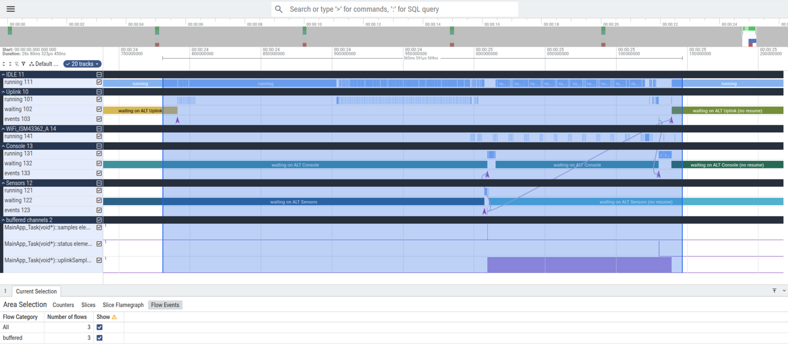

# 6. Tracing: watching the process network at work

The build configuration **Debug-Trace** records what the processes do -- every channel operation,
every ALT, every wait and wake-up, every thread switch -- into a ring buffer in RAM. You stop the
board in the debugger, copy the ring to the PC, convert it and look at it as a timeline in Perfetto.
This chapter takes you through it step by step.

> **Note: an unreleased trace format.** Debug-Trace uses the source of CSP4CMSIS's unreleased
> `dev/tracing` branch (version 3.2.0 in `csp_version.h`, commit `ca2610a`, in `lib/csp4cmsis-trace/`;
> see its `VERSION`). The record format, the event numbers and the tools may still change before a
> release. Debug and Release use the released CSP4CMSIS 3.1.0 (`lib/csp4cmsis/`) and contain no trace
> code at all: they build to exactly the same image as without Debug-Trace (checked,
> `docs/results/2026-11-14_tracing.md`).

**Tested with:** the tools of chapter 1, Python 3.13 (Ubuntu 25.04), Google Chrome with
<https://ui.perfetto.dev>, and optionally ProB 1.x (`probcli`) for the conformance check. Windows: the
Python scripts run unchanged; the shell scripts in `tools/` need Git Bash or WSL (not tested).

---

## 6.1 What gets recorded, and where

| Part | File | What it does |
|---|---|---|
| Trace hooks in the library | `lib/csp4cmsis-trace/csp4cmsis/...` (`CSP4CMSIS_TRACE`) | each channel put/get, ALT guard/selection/deadline, wait/resume becomes an event |
| Ring backend | `lib/csp4cmsis-trace/csp4cmsis/src/csp_trace_ring.c` (`CSP4CMSIS_TRACE_BACKEND_RING`) | writes each event as a 16-byte record: cycle-counter time stamp, event id, sequence number, two values |
| The ring | `Core/Src/csp_trace_board.c`, `csp_trace.ld` | 1024 records (16 KB + 32-byte header) in SRAM2 at `0x10000000`, `NOLOAD`: flashing does not touch it, `csp_trace_ring_init()` clears it before `main()` |
| Heartbeat | `vApplicationTickHook()` in `csp_trace_board.c` | one record per second, so that the 32-bit cycle counter can be unwrapped |
| Thread switches | `Core/Inc/FreeRTOSConfig.h`, USER CODE Defines | FreeRTOS's `traceTASK_CREATE`, `traceTASK_SWITCHED_IN/OUT` hooks: which thread runs when |

All of these exist only when `CSP4CMSIS_TRACE` is defined, which only Debug-Trace does. The hooks in
`FreeRTOSConfig.h` sit in a USER CODE section and survive regeneration in STM32CubeMX (checked).

**How long the ring lasts.** Measured on the board (`docs/results/2026-11-14_tracing.md`): between
uploads the program writes about 13 records per second -- a heartbeat per second and about 59 records
per sample every 5 s (Sensors reads, Console prints, Uplink takes the sample). One ThingSpeak upload
writes about 690 records in 0.35 s, up to 4500 per second: the Wi-Fi driver waits for the module by
checking a pin every millisecond, and each check is a thread switch to the idle thread and back. The
ring keeps the **newest** 1024 records (policy *overwrite*): about one upload plus 20 s of normal
work. So:

**Dump the ring within about 20 s after an `Uplink: ... -> entry` line** if you want to see an
upload. Later, the upload has been overwritten by normal work. (SRAM2 cannot hold a larger ring:
2048 records would be 32 KB + 32 bytes. The other policy, *stop when full*, would keep only the
first 1024 records after reset -- the Wi-Fi join fills those within a second.)

---

## 6.2 Build and run Debug-Trace

1. STM32CubeIDE: **Project > Build Configurations > Set Active > Debug-Trace**, then **Project >
   Build Project**. Headless:
   ```bash
   ~/st/stm32cubeide_2.1.0/headless-build.sh -data /tmp/ws -import "$PWD" -build DISCO_L475VG_IOT01A_Thingspeak/Debug-Trace
   ```
   You should now see `Build Finished. 0 errors, 0 warnings.` and
   `Debug-Trace/DISCO_L475VG_IOT01A_Thingspeak.elf`.
2. Flash and run it as usual (chapter 3), with a serial terminal on the virtual COM port. The console
   output is the same as in Debug.
3. Wait for an upload line, e.g.
   `[  67.394 s] Uplink: sample #14 -> entry 235694 (328 ms)`, then go to 6.3 within 20 s.

---

## 6.3 Copy the ring to the PC

The ring must be read while the core is **halted**, so that it does not change during the copy.

**With the script** (Ubuntu; it starts the ST-LINK GDB server in *attach* mode -- no reset --, lets GDB
connect, which halts the core, dumps the ring, reads the threads' names, and lets the board run on):

```bash
tools/trace_dump.sh Debug-Trace/DISCO_L475VG_IOT01A_Thingspeak.elf trace_out/ring.bin
```

You should now see the ring header, the thread names and

```
$1 = {magic = 0x52505343, format = 0x1, record_size = 0x10, capacity = 0x400, policy = 0x0, write_count = 0x319c8, clock_hz = 0x4c4b400, dropped = 0x0, dwt_ctrl = 0x40000001}
TASKNAME 0x20001138 Sensors
TASKNAME 0x20001a70 Console
TASKNAME 0x20002ba8 Uplink
TASKNAME 0x20003ac4 WiFi_ISM43362_A
TASKNAME 0x2000a3c4 IDLE
== wrote trace_out/ring.bin (16416 bytes) and trace_out/ring.names (5 names); the board is running again
```

`magic` 0x52505343 is "CSPR"; `capacity` 0x400 = 1024 records; `clock_hz` 0x4c4b400 = 80 MHz.

**Why the names are read separately.** The decoder names a thread after its process's `name()`
(`SensorsProcess::name()` returns `"Sensors"`, and so on). CSP4CMSIS records that name once, when the
process starts (`ProcessName`); in an overwrite ring that holds an upload, those records were
overwritten long ago, and the decoder would fall back to the symbol of the thread's control block
(`MainApp_Task(void*)::sensors`). The name is also in FreeRTOS's control block (`pcTaskName`:
CSP4CMSIS's `Run` passes `name()` to `osThreadNew`), so the script reads it there while the core is
halted (`tools/trace_names.py`) and writes `ring.names`, which 6.4 uses. FreeRTOS keeps at most 15
characters (`configMAX_TASK_NAME_LEN` 16), hence `WiFi_ISM43362_A` for the Wi-Fi driver's thread.

**By hand in STM32CubeIDE** (any OS): start a debug session for Debug-Trace (**Run > Debug As > STM32
C/C++ Application**), let it run, wait for the upload line, press **Suspend** (pause button), and in
the **Debugger Console** tab type:

```
dump binary memory ring.bin &csp_trace_ring ((char *)&csp_trace_ring) + sizeof(csp_trace_ring)
```

`ring.bin` is written to the debugger's working directory (the project's `Debug-Trace` folder). It
must be 16416 bytes. Without `ring.names` the threads keep their symbol names in Perfetto; to get the
process names, type `print ((TCB_t *)0x20001138)->pcTaskName` for each thread address and write the
lines `TASKNAME <address> <name>` into `ring.names` next to `ring.bin`.

---

## 6.4 Convert and check

```bash
tools/trace_decode.sh trace_out/ring.bin Debug-Trace/DISCO_L475VG_IOT01A_Thingspeak.elf trace_out
```

runs, from CSP4CMSIS's `tools/trace`:

1. `ring2log.py ring.bin -o events.log --report ring_report.txt` -- the records as an Event Recorder
   log. **Check the report** (example):
   ```
   ring: capacity 1024 records, policy overwrite oldest, write count 21721, clock 80000000 Hz, DWT_CTRL 0x40000001
   records kept: 1024 (write index 20697..21720); overwritten 20697; dropped 0; torn 0; orphan continuation records 0
   events: 885 over 27.000000 s (33 events/s, 38 records/s)
   heartbeats: 28 (beats 52..79); intervals not about 1 s: none
   ```
   `torn 0` (no record half-written when the core was halted), `orphan continuation records 0` (no
   multi-record event cut in half by the ring's wrap), `dropped 0`, and heartbeats 1 s apart: the
   ring is consistent. "Overwritten" is expected with the overwrite policy.
2. `decode.py -a <elf> -I trace/FreeRTOS_ring.scvd --no-eventlist events.log -o events.csv
   --summary summary.txt --checks checks.json --stable stable.csv --perfetto trace.json` -- names the
   events, resolves addresses to symbols (`MainApp_Task(void*)::uplinkSamples` for the channel object),
   checks the library's state, and writes the Perfetto file. **`--no-eventlist` is the normal path:**
   `decode.py` then reads the log itself, which covers everything this project records (CSP4CMSIS and
   FreeRTOS events), and you need nothing beyond Python 3. `eventlist` from Arm's CMSIS-Toolbox is
   optional: if it is on the `PATH` (or `EVENTLIST` names it), the script uses it for decoding
   instead. All traces in this project were decoded without it (`eventlist` was not tested). You should see `== eventlist not found: decode.py --no-eventlist`.
   The summary ends with the checks (here of dump d in `docs/results/2026-11-14_tracing.md`):
   ```
   ring slots: FAIL 1; 11 puts, 12 gets (11 read their put's slot), 0 overwrites (0 evicted the oldest put's slot), 0 dropped (0 without slot)
   ALT offers: PASS; 17 waits, 41 enabled guards, 0 unresolved, 43 guards described
   ALT deadlines: FAIL 3; 17 timeout waits (17 AltDeadline), 5 ResumeTimeout (at most 0 ticks after the deadline), 9 Resume (9 before the deadline, 0 at it, 0 after)
   ```
   **The FAILs here are not errors of the program: they come from where the window starts.** The
   ring holds only the newest 1024 records, so the trace begins in the middle of things. Each process
   is already waiting at that moment, but the `WaitAlt` and `AltDeadline` that started its wait lie
   before the window. When its wait ends, the checker sees a `Resume` or `ResumeTimeout` "without a
   deadline wait" and reports it: three processes (Sensors, Console, Uplink), three "ALT deadlines"
   reports. In the same way, a get from a channel whose put was before the window is reported under
   "ring slots" ("get from an empty replay"); and if the window begins while a process is setting up
   an ALT, the `AltGuard` records of its first guards are missing, which is reported as
   `ALT offers: FAIL; ... 2 unresolved` with `WaitAlt names 4 guards, 2 described` in `checks.json`
   (`alt_errors`) -- seen in the rehearsal of chapter 3, where the window began 0.07 ms before the
   Console's `WaitAlt`. `checks.json` lists each report with its time
   (`deadline_errors`, `ring_errors`, `alt_errors`): if every one lies at the start of the window -- before the
   process's first own `WaitAlt` in `events.csv` --, it is such an artefact. What matters is the rest
   of the line: `at most 0 ticks after the deadline` and `0 before the deadline` among the timeouts
   (no timeout ever woke a process early or late), and `0 overwrites` / `0 dropped`.
   If `ring.names` lies next to `ring.bin`, `tools/trace_names.py apply` then replaces the symbol names
   of the threads in `trace.json` with the process names and prints
   `trace_names: MainApp_Task(void*)::sensors -> Sensors` etc. `events.csv` and `summary.txt` keep the
   symbol names.
3. With ProB installed (`export PROBCLI=/path/to/probcli`): `csp_trace.py` checks parts of the trace
   against CSP models of the library (`lib/csp4cmsis-trace/docs/formal/`), with deliberately broken
   copies ("mutations") that must fail. See 6.7.

---

## 6.5 Look at it in Perfetto

1. Open <https://ui.perfetto.dev> in Chrome. (Perfetto runs in the browser; the trace is not uploaded.)
2. **Open trace file** (left), choose `trace_out/trace.json`.
3. Press **W** (zoom in) and **S** (zoom out), **A**/**D** to move, or drag on the time axis.

You should now see a group of tracks for each thread and one for the buffered channels (Perfetto
may order the groups differently from Figure 6.1; drag a group's name to move it):

- one group per thread, named after its process (6.3): `Sensors`, `Console`, `Uplink`, `IDLE`
  (FreeRTOS's idle thread) and `WiFi_ISM43362_A` (the Wi-Fi driver's own thread). Without
  `ring.names` the groups carry the symbols of the control blocks instead
  (`MainApp_Task(void*)::sensors`, ..., `Idle_TCB.3`, `async_thread_cb_mem`). Each group has three
  tracks:
  - **running**: when the thread has the CPU;
  - **waiting**: from a `Wait...` event (e.g. `WaitAlt`) to the `Resume` that ends it;
  - **events**: the CSP4CMSIS events as instants (`AltGuard`, `AltSelected`, `BufferedPut`, ...).
- **buffered channels**: one counter per channel that was used in the window --
  `MainApp_Task(void*)::samples`, `::status`, `::uplinkSamples` -- showing how many elements are in the
  buffer (0 or 1 for the capacity-1 channels). (`::check` is written once, at start-up.)
- **interrupts**: interrupt handlers that recorded events. None in this program, so the group is
  empty and Perfetto may not show it.

### An upload, step by step



*Figure 6.1: the Perfetto view of `docs/results/2026-11-14_trace_upload_names/trace.json`, recorded on
the board (open it yourself to follow along without a board). Zoomed to about 24.74..25.21 s; the
time range 24.781..25.146 s (365.6 ms, shown above the tracks) is selected by dragging across the
tracks with the mouse, so the panel at the bottom, **Current Selection > Flow Events**, counts the
flows in it: 3. The selection covers the whole upload (24.791..25.139 s) with about 10 ms on each
side.*

The thread groups carry the process names (6.3); the channels under **buffered channels** keep their
symbol names (`MainApp_Task(void*)::samples`, `::status`, `::uplinkSamples`), because a channel has
no name of its own in CSP4CMSIS.

**What the figure shows.** At the top, the overview of the whole 26 s window (the marks every 5 s
are the samples; the denser marks at the right end are the upload) and the time axis of the zoomed range: labels
such as `00:00:24 950000000` mean 24.950 000 000 s, and the bar under them marks the selection with
its length (365 ms 591 us). Below, from top to bottom, the groups `IDLE`, `Uplink`, `WiFi_ISM43362_A`,
`Console` and `Sensors`, each with its **running** track (blue slices: the thread has the CPU), and for
the three processes also **waiting** (long coloured slices: waiting in an ALT) and **events**
(arrowheads: CSP4CMSIS events). At the bottom the **buffered channels**: the purple area in
`uplinkSamples` is the time a sample sat in that channel. The thin lines between the tracks are the
flows from each put to the get that took its value. The shaded area is the selection, and the panel
at the very bottom counts its flows.

This upload was chosen because a sample arrived while it ran. All times are from the start of the
window (the oldest record in the ring); `events.csv` lists each event with its exact time.

1. **24.791 s -- the Uplink's timeout is selected.** The Uplink waits in an ALT on two guards: an
   input from `uplinkSamples` and a timeout at the next upload time. The timeout fires exactly at its
   deadline (`ResumeTimeout ... tick=8154711, deadline=8154711`, then `AltSelected ... guard=1`), and the
   waiting slice on the `Uplink` track ends. The Uplink now uploads the newest sample it holds.
2. **24.79..25.13 s -- the upload.** On `Uplink > running` you see a comb of thin slices: the Wi-Fi
   driver waits for the module by checking its data-ready pin every millisecond (`osDelay(1)`), so the
   Uplink runs for a few microseconds, sleeps for 1 ms (`IDLE` runs), and runs again: 117 switches to
   the Uplink, 156 to the idle thread and 49 to the driver's own thread `WiFi_ISM43362_A` in 0.34 s.
   Everything else carries on undisturbed: the Uplink runs at `osPriorityLow`, below Sensors and
   Console (`osPriorityBelowNormal`, `Core/Src/app.cpp`), and gives the CPU away at every poll.
3. **25.0093 s -- a sample arrives during the upload.** `Sensors` wakes on its 5 s timeout
   (`waiting` ends), reads the two sensors over I2C (a short `running` slice) and puts the sample into
   both channels: `samples` (to the Console) and `uplinkSamples` (to the Uplink). The counters under
   **buffered channels** step to 1. `Sensors` goes back to waiting.
4. **The Console takes its copy at once.** 37 us after the second put, `Console` resumes from its
   ALT and gets the sample from `samples` (counter back to 0; 111 us after that put), prints the line `#... T = ...` (its `running` slice),
   and waits again at 25.015 s.
5. **The Uplink's copy waits in `uplinkSamples`.** The Uplink is busy uploading and is not in its
   ALT, so its copy stays in the channel: the `uplinkSamples` counter stays at 1 for 129.7 ms, from
   25.0093 s to 25.1390 s. Nothing is lost and nothing blocks: Sensors never waits for the Uplink. This
   is what the buffered channel with capacity 1 and KeepNewest is for.
6. **25.1300 s -- the upload's result goes to the Console.** The Uplink puts a status message into
   `status` (`Uplink: sample #... -> entry ...`); the Console resumes, gets it and prints it.
7. **25.1390 s -- the Uplink takes the sample.** Back in its ALT, the Uplink finds `uplinkSamples`
   ready, selects guard 0 at once (no waiting), gets the sample (counter to 0), keeps it for the next
   upload, and waits again -- on the same two guards, with a timeout now about 60 s later.

**The three flows in the selection** (the arrows, and "3" in **Flow Events**) connect each put with
the get that took its value:
`samples` (Sensors -> Console, 111 us), `uplinkSamples` (Sensors -> Uplink, 129.7 ms -- the long arrow
across the upload), and `status` (Uplink -> Console). Click an arrow's end to see the channel, writer and
reader.

**"(no resume)"** at the right edge of a waiting slice (e.g. *waiting on ALT Sensors (no resume)*):
the wait was still open when the ring was dumped -- the core was halted while the process waited. It
is not an error.

**The CPU is mostly idle.** Over the 26 s window `IDLE` has the CPU 96 % of the time; Sensors, Console
and Uplink together less than 0.3 %, even with an upload in the window.

**Track numbers.** The numbers after the track names (`Uplink 12`, `running 121`, ...) are Perfetto's
own process and track IDs from `trace.json` (decode.py numbers the threads in order of appearance).
They have no meaning on the board.

**The same pattern every 5 s.** Outside the upload you see the steps 3, 4 and 7 alone: Sensors puts,
the Console takes its copy after about 0.1 ms and prints, and the Uplink, with its lower priority,
takes its copy after the Console has finished, 5.7 ms after the put; then everything waits again.

**KeepNewest, seen in the trace.** A sample that arrives *during* an upload is not lost: it stays in
`uplinkSamples` (counter 1) and the Uplink's get follows right after the upload. A KeepNewest channel
overwrites only when a second put comes before the reader's get, i.e. when the Uplink is busy for
longer than one sample period (5 s) -- in this program only while it joins the network (about 5.7 s
at start-up, 16 s for a failed join). Then the second put is recorded as `OverwroteOldest` (shown as a
put slice), and the put it replaced, if it is still in the window, is labelled *(overwritten, never
read)*. Because the join writes about 4000 records per second, the ring holds such a moment for only
a quarter of a second: catch it with a breakpoint (6.6).

**Timeouts.** Each ALT with a timeout records its deadline (`AltDeadline`); a timeout wake-up is
`ResumeTimeout`. The decoder checks that no timeout ends before its deadline ("ALT deadlines" in
`summary.txt`).

---

## 6.6 Catching a rare event with a breakpoint

To stop exactly when the Sensors process overwrites an unread sample in `uplinkSamples`, set a
breakpoint on the line of `offer()` that records the overwrite, let the board start (the join at
start-up keeps the Uplink busy for about 5.7 s), and dump when it hits:

```
(gdb) break buffered_channel.h:200
(gdb) continue
Breakpoint 1.3, csp::internal::BufferedChannel<Sample, 1u, (csp::BufferPolicy)1>::offer (this=0x200005f4 <(anonymous namespace)::MainApp_Task(void*)::uplinkSamples>, ...)
(gdb) next
(gdb) dump binary memory ring.bin &csp_trace_ring ((char *)&csp_trace_ring) + sizeof(csp_trace_ring)
```

`next` executes the trace call, so the record is in the ring. In STM32CubeIDE: double-click left of
line 200 of `lib/csp4cmsis-trace/csp4cmsis/inc/csp/buffered_channel.h`, debug, and use the Debugger
Console for `dump`. On the lab board it stopped at tick 5042 ms; the decoded window (0.26 s) shows
`uplink` and the idle thread alternating 253 times (the join), `sensors` waking on its timeout, a put
into `samples`, and `OverwroteOldest` on `uplinkSamples`.

## 6.7 Conformance check (optional, needs ProB)

`csp_trace.py` cuts the trace into projections -- one per ALT selection and one per buffered channel --
and checks each against the CSP model of the library construct, with ProB:
`MODEL \ H [T= RECORDED`, i.e. the recorded behaviour is one the model allows. For each model it also
checks a deliberately falsified copy, which must fail (otherwise the check proves nothing).

With this program, the KeepNewest channels of capacity 1 are checked; the ALTs are outside the
models' parameter range (their timeouts are thousands of ticks; the models cover 0..15) and are
listed as unmatched, which is not a failure. Stable points and their checks need the `ProcessStart`
events, which are written once at start-up and are therefore no longer in an overwrite ring that holds
an upload. A get at the start of the window whose put lies before it (the window-start artefact of
6.4) is passed to ProB as `rd.UNKNOWN`, which ProB cannot parse: that channel's check is then
reported as UNKNOWN, while its mutation is still checked. Results:
`docs/results/2026-11-14_tracing.md`.

---

## 6.8 What tracing costs

| | Debug | Debug-Trace | Difference |
|---|---|---|---|
| Code (text) | 109 664 B | 113 416 B | +3 752 B |
| RAM (data + bss) | 48 528 B | 64 960 B | +16 432 B (ring in SRAM2, otherwise unused) |
| CPU per record | -- | at most about 370 cycles = 4.6 us at 80 MHz | |
| CPU, during an upload | -- | at most about 2 % | |
| CPU, averaged over a 60 s cycle | -- | about 0.01 % | |

(How the CPU figures were obtained: `docs/results/2026-11-14_tracing.md`.)

---

## 6.9 Troubleshooting

- **`ring2log.py`: bad magic** -- `ring.bin` was dumped from a Debug or Release build (no ring), or
  not from `&csp_trace_ring`. Check the active build configuration.
- **No upload in the trace** -- dumped too late (6.1): dump within 20 s after the upload line.
- **`trace_dump.sh` resets the board** -- an old copy without `-g` (attach) for `ST-LINK_gdbserver`.
- **Torn records > 0** -- the core was not halted during the copy (a debugger reading memory while the
  program runs). Use the script or suspend first.
